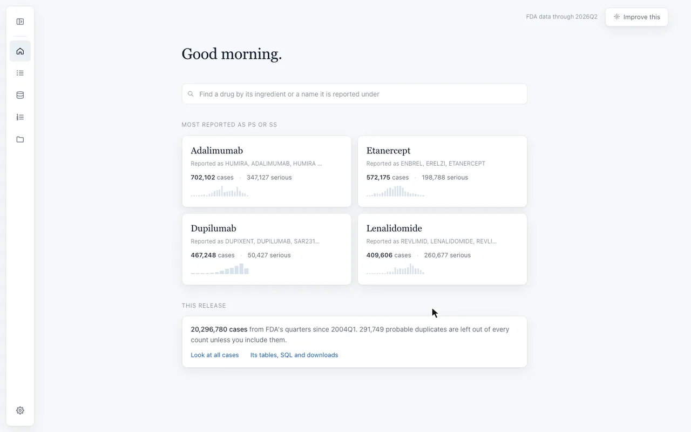
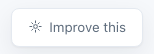

<p align="center">
  
</p>

<h1 align="center">Open Altio</h1>

<p align="center">
  <strong>Public drug safety data, cleaned in the open, free for anyone.</strong>
</p>

<p align="center">
  <a href="https://open.altioai.com">Look at the data</a> &nbsp;·&nbsp;
  <a href="#run-it-yourself">Run it yourself</a> &nbsp;·&nbsp;
  <a href="https://altio-ai.github.io/open-altio/">Docs</a> &nbsp;·&nbsp;
  <a href="CONTRIBUTING.md">Contribute</a>
</p>

<p align="center">
  
  
  
</p>

Regulators publish reports of harm from medicines, but as raw files that take a specialist weeks to clean. Open Altio does that work once, openly, so a patient, a doctor, a student or a small company can look for themselves.

It starts with FDA's Adverse Event Reporting System (FAERS, and the legacy AERS before it): every quarter since 2004. More public sources will follow.

<picture>
  <source media="(prefers-color-scheme: dark)" srcset="docs/assets/explorer-dark.webp">
  
</picture>

## Start here

| If you are | Start with |
|---|---|
| A safety scientist, physician or researcher | [**Look at the data**](#look-at-the-data) online. Nothing to install. |
| A data scientist or engineer | [**Run it yourself**](#run-it-yourself) and change how the data is cleaned. |
| Leading a safety or data team | [**Why you can rely on it**](#why-you-can-rely-on-it) |

## Look at the data

Apply on [open.altioai.com](https://open.altioai.com). It is free, and most applications are approved within a day. Then you can:

- **Find every report on a medicine,** under any name it was reported. FDA's 17 spellings of dupilumab, Dupixent included, count as one medicine.
- **See whether a reaction is already known.** For each suspect drug, whether today's US prescription label lists the reaction.
- **Look for safety signals.** EBGM, PRR, ROR and IC for every drug and reaction, and for whole drug classes.
- **Read any case in full,** in the order a safety reviewer reads it, with FDA's values under ours.
- **Filter, export and query.** By drug, reaction, date, age, sex, country or company; export what you see, or query any table with SQL.

## Run it yourself

It runs only on your machine, with no sign-in and no telemetry.

> [!TIP]
> **The quickest way:** point your coding agent at this repository and ask it to set Open Altio up for you. It reads this page and [AGENTS.md](AGENTS.md), checks your machine and runs the demo.

Or follow the steps for your computer:

<details>
<summary><strong>On a Mac</strong> (or Linux)</summary>

1. **Open Terminal,** the Mac's window for typing commands. Press <kbd>⌘ Command</kbd> + <kbd>Space</kbd>, type `Terminal` and press <kbd>Return</kbd>.
2. **Install uv,** the tool that installs Open Altio and the Python it needs. Paste this line and press <kbd>Return</kbd>:
   ```sh
   curl -LsSf https://astral.sh/uv/install.sh | sh
   ```
3. **Close Terminal and open it again,** so it finds uv.
4. **Install Open Altio:**
   ```sh
   uv tool install open-altio
   ```
5. **Check your machine.** It says All good, or what is short and what to do:
   ```sh
   open-altio doctor
   ```
6. **Run the demo.** It downloads FDA's latest quarter, builds it in about 30 seconds and opens the explorer in your browser:
   ```sh
   open-altio demo
   ```
   To stop it, press <kbd>Control</kbd> + <kbd>C</kbd> in Terminal.

</details>

<details>
<summary><strong>On Windows</strong></summary>

1. **Open PowerShell,** Windows' window for typing commands. Press the <kbd>Windows</kbd> key, type `PowerShell` and press <kbd>Enter</kbd>.
2. **Install uv,** the tool that installs Open Altio and the Python it needs. Paste this line and press <kbd>Enter</kbd>:
   ```powershell
   powershell -ExecutionPolicy ByPass -c "irm https://astral.sh/uv/install.ps1 | iex"
   ```
3. **Close PowerShell and open it again,** so it finds uv.
4. **Install Open Altio:**
   ```powershell
   uv tool install open-altio
   ```
5. **Check your machine.** It says All good, or what is short and what to do:
   ```powershell
   open-altio doctor
   ```
6. **Run the demo.** It downloads FDA's latest quarter, builds it in about 30 seconds and opens the explorer in your browser:
   ```powershell
   open-altio demo
   ```
   To stop it, press <kbd>Ctrl</kbd> + <kbd>C</kbd> in PowerShell.

</details>

<details>
<summary><strong>Other ways to install</strong></summary>

- `pipx install open-altio` or `pip install open-altio`, with Python 3.12 or later.
- The container image `ghcr.io/altio-ai/open-altio`, which runs the explorer and every command.

</details>

### Can my computer handle it?

| | Download | Time | Memory | Free disk |
|---|---|---|---|---|
| `open-altio demo`: the latest quarter | about 65 MB | about 30 seconds to build | 4 GB | 2 GB |
| `open-altio fetch`, then `open-altio build`: all of FAERS | about 3.5 GB | about an hour to download, an hour to build | 12 GB (a 16 GB laptop) | 50 GB |

### Then

- **All of FAERS,** built from FDA's own files on your laptop. Nothing is sent to us.
- **Your own rules.** Run `open-altio serve`, open **How we clean FAERS**, switch a rule off or change a value, and rebuild. Your choices are saved in a `rules.toml` beside the release, and the release records how they differ from the rules Altio uses for its own releases.
- **Your own tools.** A release is a folder of Parquet tables and a DuckDB database, documented column by column in the [data dictionary](docs/reference/data-dictionary.md).

## Why you can rely on it

- **FDA's values are never changed.** Every column is marked **FDA** or **Open Altio**, so you always see what FDA said and what we did.
- **Our work sits beside FDA's.** Columns we work out end in `_T`: dates as dates, ages in years, countries as ISO codes, one latest version per case. The explorer shows our value, with a small "FDA: x" beside it when FDA's differs.
- **Drug names are read to their ingredients** with the [DiAna dictionary](https://osf.io/zqu89/), an open list from the University of Bologna.
- **Duplicates are flagged, never deleted.** One switch shows them again.
- **Every step is explained:** what it does, why, and how many cases it moved, on the methods page ([open.altioai.com/methods](https://open.altioai.com/methods), or `/methods` in your own explorer).
- **Everything is in the open.** The code, every rule and the notebooks behind each step are in this repository.
- **Free, and maintained by a company.** Open Altio is maintained by Altio AI, which makes commercial software for drug safety teams. That software is built on the same cleaned data, with the same rules.

## Licences

| What | Licence |
|---|---|
| The code | Apache-2.0 ([LICENSE](LICENSE), [NOTICE](NOTICE)) |
| Releases from open.altioai.com | The [Open Altio Data Licence](https://open.altioai.com/licence) |
| A release you build yourself | Yours. FDA data is public domain; credit only what you used from others, such as DiAna (CC BY 4.0), as [NOTICE](NOTICE) lists. |

## What's in this repository

```text
open-altio/
├── src/              the Python package
├── rules/            one file per rule
├── mappings/         reviewed cleaning tables
├── notebooks/        evidence behind each step
├── docs/             the documentation site
├── scripts/          checks and maintenance helpers
├── tests/            the test suite
├── .github/          checks, releases, issue forms
├── README.md         start here
├── AGENTS.md         how agents work here
├── CLAUDE.md         points to AGENTS.md
├── CONTRIBUTING.md   how to contribute
├── CHANGELOG.md      what changed, by version
├── SECURITY.md       reporting a security problem
├── LICENSE           Apache-2.0
├── NOTICE            credits and third-party notices
├── CITATION.cff      how to cite
├── pyproject.toml    the package's metadata
├── uv.lock           pinned dependency versions
├── mkdocs.yml        the docs site's settings
├── Dockerfile        the container image
├── .dockerignore     left out of the image
└── .gitignore        left out of git
```

Inside `src/`, each part is described in [How the code fits together](docs/contribute/architecture.md).

## Help and contributing

**We want to hear from you.** Open Altio is here to help people, and every report, question and fix makes it better for everyone.

- **Using the explorer?** Press "Improve this" at the top right of any page. It sends your note straight to us, with no account needed.<br><picture><source media="(prefers-color-scheme: dark)" srcset="docs/assets/improve-this-dark.png"></picture>
- **Something wrong in the code?** [Open an issue](https://github.com/Altio-AI/open-altio/issues/new/choose), or run `open-altio report` to open one with the details filled in. We aim to reply within a week, with the next step: confirmed, a question, or a no with the reason.
- **Contributing:** [CONTRIBUTING.md](CONTRIBUTING.md). Contributions made with AI are welcome, openly; a person owns each one.
- **Docs:** [altio-ai.github.io/open-altio](https://altio-ai.github.io/open-altio/), for using it, customising it, contributing, and every command, rule and column.

[Security](SECURITY.md) · [Citing](CITATION.cff) · [Changelog](CHANGELOG.md)

> [!NOTE]
> FAERS reports do not establish that a product caused an event. FDA has not reviewed or endorsed Open Altio.
